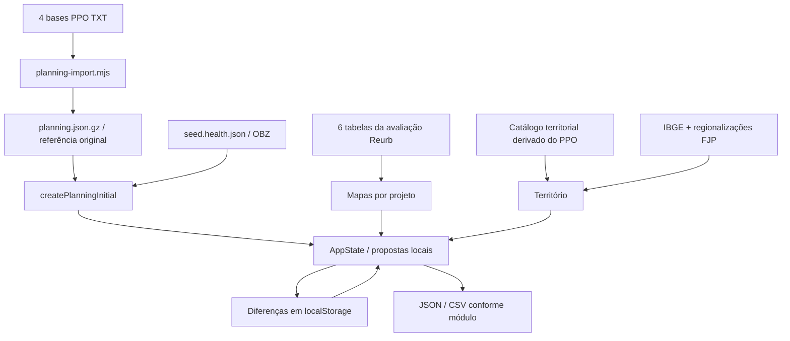

# Inventário dos dados e da arquitetura existente

Este levantamento descreve o sistema no commit **cfda6499a4130e2889245c6e43a4cede44f4cf62**, analisado em 20/10/2026. Não reorganiza fontes, não altera telas, não implementa PostgreSQL e não migra dados. O escopo são os arquivos versionados e o código; alterações privadas salvas no navegador do usuário não foram inspecionadas.

## Arquivos deste levantamento

- [datapackage.json](datapackage.json): 90 recursos documentais e físicos, campos, chaves, proveniência, relações e módulos.
- [dicionario-campos.csv](dicionario-campos.csv): 1469 descrições de campos por recurso/caminho, incluindo propriedades aninhadas e referências a tipos.
- [fontes.csv](fontes.csv): situação de cada fonte, arquivo derivado ou exemplo.
- [validar.py](validar.py): valida o inventário contra os arquivos do checkout; opcionalmente verifica os esquemas oficiais Data Package/Table Schema.

**90 recursos não significam 90 tabelas PostgreSQL.** O descritor distingue arquivos físicos, coleções aninhadas, objetos de estado e projeções da mesma informação. As 1.469 linhas do dicionário também não são 1.469 campos de negócio distintos: original, proposta, espelho e origem podem repetir o mesmo conteúdo.

O modelo completo de "Texto colado.txt" não ficou acessível nesta sessão; só apareceu a prévia com "dados_siafi". Por isso foi usado o padrão Data Package/Table Schema, com extensões `x-*`. Não foi identificada integração SIAFI no sistema.

## Como ler o datapackage

Cada recurso informa camada, módulo e origem. Recursos físicos CSV/TXT usam `path` com URL fixada no commit analisado. Recursos que representam coleções dentro de JSON, gzip ou do estado usam `x-binding`, com arquivo, seletor ou expressão de acesso.

**Nos recursos `x-inventory-only=true`, `data: []` é apenas suporte à descrição do esquema. Não representa uma exportação de registros vazios nem contém os dados do navegador.** As contagens observadas ficam em `x-observed` e a localização dos dados em `x-binding`.

- `schema.fields`: nomes exatos e tipos.
- `schema.primaryKey` e `foreignKeys`: identidades e referências diretas que podem ser descritas no esquema.
- `x-relationships`: relações condicionais, por arrays/dicionários, contextuais ou polimórficas.
- `x-definitions`: os 46 tipos de objetos/interfaces existentes, inclusive estruturas reutilizadas.
- `x-properties`, `x-items` e `x-values`: propriedades de objetos, elementos de arrays e valores de dicionários.
- `x-type-reference`: aponta para uma definição reutilizada.
- `x-origin-field`: coluna PPO da qual uma propriedade simplificada deriva.
- `x-optional` e `x-nullable`: refletem TypeScript; não definem a obrigatoriedade administrativa de preenchimento.
- `x-source-status` e `x-modules`: classificam arquivos e consumidores.

As chaves de `OfficialFields`, `source.raw` e outros dicionários são abertas. Foram mapeadas as observadas e as explicitamente utilizadas nas telas; uma planilha importada futuramente pode acrescentar outras.

## Arquitetura que existe hoje

O aplicativo é React/TypeScript/Vite, publicado como site estático. Não há backend, banco PostgreSQL nem autenticação de usuários. `mockApi` é uma fachada em memória/localStorage. Perfis e permissões são simulados no domínio e na interface.



O carregamento preserva a referência original, cria o estado de trabalho e reaplica as diferenças locais. A restauração consulta a referência correspondente. Não existe uma API central que sincronize os navegadores.

## Camadas e fontes

As três famílias principais são **planejamento PPO**, **avaliação/mapas Reurb** e **OBZ**. IBGE e FJP enriquecem território. O catálogo físico/financeiro territorial deriva do PPO, portanto não é uma quarta base orçamentária independente.

| Camada no descritor | Recursos |
| --- | ---: |
| proposta | 4 |
| cadastro-local | 15 |
| derivado-editavel | 4 |
| proveniencia | 2 |
| derivado | 5 |
| obz | 1 |
| estado | 1 |
| referencia-proposta | 9 |
| referencia | 5 |
| historico | 1 |
| referencia-ppo | 4 |
| origem-ppo | 4 |
| avaliacao-reurb | 14 |
| origem-obz | 2 |
| referencia-ppo-derivada | 2 |
| apoio-territorial | 3 |
| modelo-csv | 13 |
| persistencia | 1 |

| Fonte principal | Registros observados | Papel |
| --- | ---: | --- |
| Programas PPO | 2.553 linhas de origem → 182 programas | Cadastros e combinações de alinhamento estratégico/ODS |
| Ações PPO | 1.046 linhas de origem → 1.044 ações | Programa + UO da ação + código; variantes preservadas na referência |
| Indicadores PPO | 237 | Indicadores vinculados a programas |
| Localizadores PPO | 44.507 | Abrangência e previsões físicas/orçamentárias por ano na origem |
| Avaliação Reurb | 37 componentes, 12 indicadores, 6 relações entre componentes e 11 vínculos indicador–componente | Desenho e referências dos mapas; não contém medições numéricas preenchidas |
| Seed OBZ Saúde | 1.502 itens e 73 registros auxiliares de ação | Itens, premissas, cenários e origem OBZ |
| Catálogo territorial PPO | 4 projetos, 7 ações e 1.034 localizadores | 28 séries físicas + 28 orçamentárias, por ação e ano |
| Municípios IBGE | 853 | Identificação, malha e validação territorial |
| Regionalizações FJP | 6 esquemas | IMEDIATAS, INTERMEDIÁRIAS, Saúde micro/macro, SRE e agrupamentos metrópole/colar/RIDE |

A contagem de linhas da origem não deve virar contagem de entidades. Os programas repetem combinações de alinhamento; as ações têm duas linhas excedentes/variantes para suas identidades. A aplicação mantém a referência e suas variantes, enquanto o estado de trabalho usa uma representação por entidade.

## Identidades, exercício e vínculos

| Objeto existente | Identidade/associação atual | Cuidado |
| --- | --- | --- |
| Programa | `ppo-programa-<código normalizado>` | Código não é chave única de linha da base bruta de programas |
| Ação | `ppo-acao-<programa>-<UO da ação>-<ação>` | Código da ação sozinho não substitui o contexto |
| Indicador PPO | Programa + hash do nome; sufixo adicional em divergências | Fonte não fornece um código oficial único no arquivo atual |
| Localizador | ID da ação + código do localizador | Código do localizador isolado não deve ser tratado como identidade global |
| Mapa de projeto | `id`, `projectId`, `projectCode`, `projectType` | Identidade do projeto está embutida no mapa; não existe `state.projects` |
| Item OBZ | ID do item + `source`/lote/origem | Associação com ação pode estar pendente, ambígua ou ausente |
| Região | `regions[].id` dentro da regionalização | ID regional não é global entre secretarias/esquemas |
| Série territorial | ID da série + período + unidade + referência/origem | Município, região e estado são escopos diferentes |

Os IDs PPO atuais **não incluem exercício**. A edição vive no manifesto e em `planning`: `exercise=2026`, `datasetId=cb4e41fdca4b90836484`. Não foi adicionado um campo fictício `edition_id` aos objetos.

O ciclo em uso foi elaborado em 2025 para a revisão/exercício de 2026, com horizonte 2026–2029. Ano do relatório Reurb, ano da regionalização e período da série são metadados distintos. As colunas 2027 do seed Saúde não autorizam inferir o exercício dos itens OBZ.

A UO responsável pelo programa e a UO responsável pela ação são informações separadas e preservadas. No Reurb, o programa 125 tem UO 1221 e a ação 4528 tem UO 2461. A normalização remove zeros iniciais para comparação/exibição; os arquivos originais continuam documentados com seus códigos de origem.

## Campos que chegam da fonte e campos locais

Programas e ações têm duas representações relacionadas: propriedades simplificadas usadas nas telas e `officialFields`, que guarda os nomes PPO. Por exemplo, `Action.finalidade` corresponde a "Finalidade da Ação"; `Program.objetivo` corresponde a "Objetivo". Não são duas finalidades independentes.

Os alinhamentos do programa vivem em `strategicLinks`; reduzir tudo ao primeiro objetivo/diretriz/ODS perderia combinações existentes. `sourceVariants` preserva variantes na referência e não precisa ser repetido integralmente nas propostas.

Há campos presentes no código que começam sem conteúdo importado:

- Programa: `problemaCentral`, `publicoAlvo` e `contexto` estão vazios nos 182 programas da referência.
- Programa: "Causas" já vem da base atual. `causeItems` é sua possibilidade de estruturação local; não é uma nova coluna exportada pelo PPO.
- Informações do gerente são complementos locais expostos na tela, ausentes da exportação atual.
- Ação: `detalhamentoImplementacao` e `orgao` chegam vazios nas 1.044 ações. O detalhamento pode ser elaborado localmente.
- Ação: `local` reúne atividades, critério/evidência de entrega, parceiros/condições, distribuição/papel/critérios/condições territoriais.
- A estrutura permite rascunhos locais sem original PPO; isso não cria automaticamente um código oficial.

As previsões anuais permanecem nas bases de origem e no catálogo territorial pertinente. O importador qualitativo exclui valores orçamentários e metas/previsões anuais de `officialFields`; isso não significa que esses campos não existam nos arquivos.

A regra de edição é calculada por `src/services/editingPolicy.ts`, a partir do perfil, da UO, da origem e do contexto. A referência é protegida; propostas e rascunhos seguem regras diferentes. Não existe um campo genérico `editable` por registro. Em propostas de registros existentes, códigos e responsabilidades são protegidos; a mudança de responsabilidade usa solicitação própria. Tipo de ação existente e território de localizador importado também têm proteção específica.

## Mapas, indicadores e projetos

O mapa por projeto (`ProjectPlanningMap`) contém componentes, indicadores e relações; `actionIds` liga o mesmo projeto a diversas ações, inclusive de programas/UOs diferentes. `ownerProgramId` define responsabilidade no aplicativo, não limita todas as ações participantes àquele programa.

O Reurb é instanciado a partir das ações do projeto estratégico de código 14 e das seis tabelas consumidas pelo serviço. As tabelas documentais `projeto_acoes` e `acoes` não são a regra de associação em execução. Relações e vínculos extraídos da avaliação começam como sugestões. Ações de componentes não foram inventadas a partir da simples participação no projeto.

Projetos locais do tipo "demais" e mapas de programa podem ter nome e identidade local. Não precisam de código estratégico oficial. Isso já está no modelo; o inventário não cria uma entidade de projeto nova.

Há quatro famílias de indicadores:

1. **PPO:** cadastro do programa e campos oficiais.
2. **Mapa de projeto:** definição do indicador, etapa, fórmula/unidade/fonte e vínculos com componentes.
3. **Territorial:** série de valores por município e período; `indicatorRef` pode ligar ao PPO ou a um mapa, mas é opcional.
4. **Espelho:** modelo próprio de indicador, sem equivalência automática com os outros três.

As 14 tabelas documentais Reurb têm esquemas próprios. Apenas seis entram diretamente no serviço de mapas: projetos, mapas, componentes, indicadores, relações de componentes e vínculos indicador–componente. `medicoes` e `componente_acoes` estão vazias; não há uma série de desempenho medido escondida nessas figuras.

## Território e previsões

O catálogo territorial atual contém Reurb (14), Captação de recursos (56), Trajeto Moda (64) e Percursos Gerais (20). Cada ação mantém previsões por ano e localizador, produto/unidade, total da ação e somatório dos localizadores.

As séries derivadas separam observações municipais, regionais e estaduais. Parcela estadual não é dividida artificialmente entre os 853 municípios. Zero municipal declarado difere de valor ausente. A representação regional também não prova que cada município recebeu a mesma parcela.

`TerritorialSeries.values` contém valores municipais individualizados; `reference.observations` preserva observações de outros escopos. `actionTotal` e `sourceTotal` permitem conferir total da ação e soma conhecida dos localizadores.

Os valores financeiros são **previsão orçamentária**, sem execução SIAFI. A malha e a regionalização não são fonte desses valores. `state.territory` guarda criações locais; referências carregadas ficam fora dessa coleção.

## OBZ e registros que podem permanecer soltos

O seed ativo é `scripts/seed.health.json`, não `src/data/seed.json`. Seus itens preservam UOs 4291, 2261, 2271, 1541 e 2321; o nome do arquivo 4291.xlsx não torna todos os registros da mesma UO.

`BudgetItemOBZ` guarda origem, exercício opcional, códigos/rótulos originais, quantidades, total declarado/calculado, cenários, priorização e situação de conciliação. O item pode existir mesmo sem `programaId`/`actionId` resolvidos.

No seed atual, exercício e linha física original da planilha não estão disponíveis para todos os itens. O adaptador usa exercício nulo e linha 0 quando desconhecidos; `source.raw.seedIndex` é posição do seed, não número de linha Excel comprovado.

`source.raw` preserva dados originais, enquanto `source.numbers`, `quantities` e `totalMode` distinguem ausência, zero, total declarado e total calculado. Alguns campos numéricos legados podem ser 0 por compatibilidade; não devem, sozinhos, determinar completude.

Não se exige um vínculo fictício para encaixar OBZ no planejamento. A conciliação distingue vinculado, pendente, ambíguo, sem correspondência e outro exercício. Deliberação COFIN numérica não equivale a aprovação booleana.

## Persistência, histórico e exportação

A chave `fpo-state-v2` grava um envelope diferencial: versão, datasetId, coleções com `upserts`/`removed` e valores locais. Não é uma cópia integral de `AppState`. Fontes OBZ inalteradas podem ser omitidas das diferenças e reidratadas a partir do original.

Existem chaves legadas e de backup para migrações/restauração. O histórico de proposta tem entidade, tipo, operação, data, razão e antes/depois; não possui `authorId`, pois não há cadastro autenticado de usuários.

As exportações atuais incluem revisão qualitativa JSON, pacote completo JSON, JSONs de espelhos, CSV simplificado OBZ e tabelas de apoio JSON. O botão de "espelho das ações" exporta ações filtradas, não a estrutura `ActionMirror` exibida em memória. Importar tabelas JSON no Admin ainda é uma prévia/toast, sem ingestão implementada.

## Módulos e fronteiras observadas

Estas são fronteiras de responsabilidade já observáveis no código; podem orientar PostgreSQL e backend posteriormente. Não foi desenhado nem criado um esquema de banco novo.

| Módulo | Recursos centrais | Responsabilidade atual |
| --- | --- | --- |
| carregamento-e-persistencia | `estado-aplicacao`, `referencia-ppo`, `persistencia-diferencial` | Carrega original imutável, cria estado inicial e reaplica diferenças locais; sem servidor. |
| programas | `programas-proposta`, `vinculos-estrategicos-programa` | Revisão qualitativa e rascunhos; original PPO preservado. |
| acoes | `acoes-proposta`, `complementos-acao`, `localizadores-ppo` | Revisão qualitativa, implementação e território/localizadores de cada ação. |
| indicadores-ppo | `indicadores-ppo` | Indicadores do programa, propostas e locais; não são os indicadores do mapa de projeto. |
| mapas-de-projeto | `mapas-projeto`, `componentes-mapa-projeto`, `indicadores-mapa-projeto` | Um mapa reúne componentes e indicadores de um projeto; participa de várias ações, programas e UOs. |
| territorio | `catalogo-territorial`, `regionalizacoes`, `series-territoriais`, `municipios` | Malha, regionalizações e séries físicas/financeiras por período; agrega sem ratear parcelas estaduais. |
| revisao | `proposta-planejamento`, `eventos-proposta`, `solicitacoes-associacao`, `avisos-importacao` | Diferenças, justificativas, histórico e pendências. |
| obz | `itens-obz`, `origens-obz`, `conciliacao-obz` | Importação, itens/cenários e conciliação opcional com o planejamento. |
| coerencia | `vinculos-coerencia`, `mapas-programa` | Relaciona OBZ e itens do modelo anterior de mapa por programa; não converte automaticamente para mapas de projeto. |
| espelhos | `espelhos`, `espelho-programa`, `espelho-acao`, `indicadores-espelho` | Representações derivadas/editáveis; espelho de ação é montado em tempo de exibição. |
| administracao | `listas-apoio`, `listas-selecao` | Listas, CSV manuais e exportação; importação JSON de tabelas é apenas prévia/toast na implementação atual. |
| marco-logico | `marcos-logicos`, `teoria-problema`, `nos-problema`, `nos-objetivo`, `alternativas` | Código/rota disponível fora do menu principal; começa vazio, sem ingestão automática da avaliação. |

O modelo anterior de mapa por programa (`state.maps`) convive com o mapa por projeto (`state.projectMaps`). `CoherenceLink` e `ComponentAssociation` apontam para componentes do modelo anterior; não se deve trocar esses IDs silenciosamente por IDs de `ProjectComponent`.

A rota de Marco Lógico continua no código, mas fora do menu principal e sem carga automática da avaliação. Objetos disponíveis no tipo não provam que já existem registros preenchidos.

## Redundâncias e riscos registrados, sem corrigir nesta entrega

| Situação | Interpretação |
| --- | --- |
| Colunas PPO repetidas em programas/ações/localizadores | Redundância de arquivos de origem; preservar proveniência e contexto |
| Propriedades simplificadas + officialFields | Duas representações do mesmo dado; precisam permanecer sincronizadas |
| Original PPO + proposta local | Separação intencional para comparar/restaurar, não duplicação descartável |
| Dois modelos de mapa | Coexistência funcional; vínculos antigos não são intercambiáveis |
| Indicadores PPO, projeto, territorial e espelho | Famílias distintas; associação deve ser explícita e opcional |
| Catálogo territorial + referências antigas Reurb | Catálogo consolidado é ativo; arquivos antigos continuam gerados/testados, sem consumo em execução |
| OBZ sem correspondência com a edição | Pendência legítima a registrar, sem reatribuir programa/UO para forçar encaixe |
| CSV/fixture FAOP com 1481 | Exemplos antigos ainda têm código inconsistente; não são a referência oficial nem entram automaticamente |
| XLSX 1261/1451/1501 | Disponíveis para importação manual, sem carga automática padrão |
| Listas de apoio/seleção com rótulos | Não são dimensões relacionais normalizadas; seletor oficial de UO deriva do PPO |

Os CSVs `elementos_despesa.csv` e `iag.csv` não têm caso específico reconhecido no importador Admin. O CSV de localizadores alimenta lista de apoio, não o cadastro estruturado `PlanningLocalizer`. HTMLs PPO em documentação são referências visuais, não bases de dados ativas.

Não foram identificados backend Postgres, execução SIAFI, autenticação, RAG/LLM, geração por IA ou mensuração de tokens no aplicativo atual. A sugestão de árvore de objetivos existente usa transformação determinística de texto.

## Conferência do inventário

Conferência executada com sucesso: **1.013 verificações**, incluindo os esquemas oficiais Data Package, Tabular Data Resource e Table Schema, na [execução de validação](https://github.com/pedrokenji0/formulacao-programatica-orcamentaria/actions/runs/39498035407). O descritor tem 90 recursos, 46 definições e o CSV tem 1.469 linhas de campos.

Na raiz de um checkout desta branch:

```text
python docs/inventario/validar.py
```

Para conferir também os esquemas oficiais distribuídos na biblioteca de referência:

```text
python -m pip install datapackage==1.15.4
python docs/inventario/validar.py --padrao
```

O validador confere nomes, chaves, referências, caminhos de fonte, cabeçalhos/contagens das bases PPO, esquemas e contagens Reurb, catálogo territorial e correspondência com o CSV. A validação do descritor não equivale a validar todos os valores de importações futuras nem o conteúdo privado do localStorage.

Referências do formato: [Data Package](https://specs.frictionlessdata.io/data-package/), [Table Schema](https://specs.frictionlessdata.io/table-schema/) e seus esquemas JSON oficiais.

## Situação dos arquivos de dados

| `data/raw/plan2026/acoes_planejamento.txt` | origem-canonica-ppo | scripts/planning-import.mjs e geradores territoriais |
| `data/raw/plan2026/indicadores_planejamento.txt` | origem-canonica-ppo | scripts/planning-import.mjs e geradores territoriais |
| `data/raw/plan2026/localizadores_Todos_planejamento.txt` | origem-canonica-ppo | scripts/planning-import.mjs e geradores territoriais |
| `data/raw/plan2026/programas_planejamento.txt` | origem-canonica-ppo | scripts/planning-import.mjs e geradores territoriais |
| `data/referencias/reurb/data/acoes.json` | referencia-documental-nao-importada-diretamente | documentação/pacote Reurb |
| `data/referencias/reurb/data/atores.json` | referencia-documental-nao-importada-diretamente | documentação/pacote Reurb |
| `data/referencias/reurb/data/componente_acoes.json` | referencia-documental-nao-importada-diretamente | documentação/pacote Reurb |
| `data/referencias/reurb/data/componente_atores.json` | referencia-documental-nao-importada-diretamente | documentação/pacote Reurb |
| `data/referencias/reurb/data/componentes.json` | referencia-importada-no-runtime | src/services/projectMapReference.ts |
| `data/referencias/reurb/data/fontes.json` | referencia-documental-nao-importada-diretamente | documentação/pacote Reurb |
| `data/referencias/reurb/data/indicador_componentes.json` | referencia-importada-no-runtime | src/services/projectMapReference.ts |
| `data/referencias/reurb/data/indicadores.json` | referencia-importada-no-runtime | src/services/projectMapReference.ts |
| `data/referencias/reurb/data/mapas.json` | referencia-importada-no-runtime | src/services/projectMapReference.ts |
| `data/referencias/reurb/data/medicoes.json` | referencia-documental-nao-importada-diretamente | documentação/pacote Reurb |
| `data/referencias/reurb/data/projeto_acoes.json` | referencia-documental-nao-importada-diretamente | documentação/pacote Reurb |
| `data/referencias/reurb/data/projetos.json` | referencia-importada-no-runtime | src/services/projectMapReference.ts |
| `data/referencias/reurb/data/relacoes_componentes.json` | referencia-importada-no-runtime | src/services/projectMapReference.ts |
| `data/referencias/reurb/data/versoes_mapa.json` | referencia-documental-nao-importada-diretamente | documentação/pacote Reurb |
| `data/territorio/metas-fisicas-reurb.json` | artefato-derivado-legado-nao-importado-pelo-runtime-atual | scripts/territory-references.test.mjs; compatibilidade e geração |
| `data/territorio/recursos-reurb.json` | artefato-derivado-legado-nao-importado-pelo-runtime-atual | scripts/territory-references.test.mjs; compatibilidade e geração |
| `src/data/seed.json` | sem-importacao-no-grafo-src | não é a semente ativa |
| `src/data/fixtures/faop.ts` | fixture-isolada-sem-importacao-no-runtime | exemplo/teste; não é cadastro oficial |
| `acoes_planejamento.txt` | fonte-do-gerador-legado-de-seed-saude | scripts/build-health-seed.cjs; não confundir com data/raw/plan2026/acoes_planejamento.txt |
| `acoes_planejamentoloaposemenda.txt` | arquivo-legado-sem-consumidor-no-carregamento-atual | não é referência da aplicação |
| `localizadores_todos_planejamento.txt` | arquivo-legado-fora-do-carregamento-atual | não confundir com data/raw/plan2026/localizadores_Todos_planejamento.txt |
| `1261.xlsx` | planilha-disponivel-sem-importacao-automatica-atual | pode ser selecionada manualmente no importador OBZ |
| `1451.xlsx` | planilha-disponivel-sem-importacao-automatica-atual | pode ser selecionada manualmente no importador OBZ |
| `1501.xlsx` | planilha-disponivel-sem-importacao-automatica-atual | pode ser selecionada manualmente no importador OBZ |
| `4291.xlsx` | origem-do-seed-obz-saude | scripts/build-health-seed.cjs; arquivo não é buscado pelo navegador na inicialização |
| `Tabelas_orcamentarias 10_06_2026.xlsx` | apoio-nao-carregado-automaticamente | não existe ingestão automática atual deste XLSX |
| `bases_csv/classificador_despesa/agrupamentos_despesa.csv` | modelo-de-entrada-manual-nao-autoload | AdminPage.BasesCsvTab; existem casos não reconhecidos pelo nome |
| `bases_csv/classificador_despesa/elementos_despesa.csv` | modelo-de-entrada-manual-nao-autoload | AdminPage.BasesCsvTab; existem casos não reconhecidos pelo nome |
| `bases_csv/classificador_despesa/elementos_itens_despesa.csv` | modelo-de-entrada-manual-nao-autoload | AdminPage.BasesCsvTab; existem casos não reconhecidos pelo nome |
| `bases_csv/classificador_despesa/fontes_recursos.csv` | modelo-de-entrada-manual-nao-autoload | AdminPage.BasesCsvTab; existem casos não reconhecidos pelo nome |
| `bases_csv/classificador_despesa/funcoes.csv` | modelo-de-entrada-manual-nao-autoload | AdminPage.BasesCsvTab; existem casos não reconhecidos pelo nome |
| `bases_csv/classificador_despesa/grupos_despesa.csv` | modelo-de-entrada-manual-nao-autoload | AdminPage.BasesCsvTab; existem casos não reconhecidos pelo nome |
| `bases_csv/classificador_despesa/iag.csv` | modelo-de-entrada-manual-nao-autoload | AdminPage.BasesCsvTab; existem casos não reconhecidos pelo nome |
| `bases_csv/classificador_despesa/subfuncoes.csv` | modelo-de-entrada-manual-nao-autoload | AdminPage.BasesCsvTab; existem casos não reconhecidos pelo nome |
| `bases_csv/obz/base_obz_modelo.csv` | modelo-de-entrada-manual-nao-autoload | AdminPage.BasesCsvTab; existem casos não reconhecidos pelo nome |
| `bases_csv/planejamento/acoes.csv` | modelo-de-entrada-manual-nao-autoload | AdminPage.BasesCsvTab; existem casos não reconhecidos pelo nome |
| `bases_csv/planejamento/localizadores.csv` | modelo-de-entrada-manual-nao-autoload | AdminPage.BasesCsvTab; existem casos não reconhecidos pelo nome |
| `bases_csv/planejamento/programas.csv` | modelo-de-entrada-manual-nao-autoload | AdminPage.BasesCsvTab; existem casos não reconhecidos pelo nome |
| `bases_csv/planejamento/unidades_orcamentarias.csv` | modelo-de-entrada-manual-nao-autoload | AdminPage.BasesCsvTab; existem casos não reconhecidos pelo nome |
| `docs/referencias/ppo/PPO-aba-acao.html` | referencia-visual-de-desenho-nao-fonte-de-runtime | documentação do formulário |
| `docs/referencias/ppo/PPO-aba-programa.html` | referencia-visual-de-desenho-nao-fonte-de-runtime | documentação do formulário |
| `public/data/planning.json.gz` | referencia-ppo-gerada-carregada | src/store/AppStore.tsx |
| `scripts/seed.health.json` | seed-obz-carregado | src/data/mockData.ts -> src/services/obzData.ts |
| `data/territorio/planejamento-projetos.json` | catalogo-territorial-consolidado-carregado | src/services/planningTerritoryReference.ts |
| `data/territorio/regionalizacoes-fjp.json` | regionalizacoes-de-referencia-carregadas | referências de regionalização territorial |
| `data/territorio/fonte-regionalizacoes-fjp.json` | proveniencia-e-conteudo-da-planilha-fjp | gerador de regionalizações; não é valor de indicador |
| `data/territorio/municipios.json` | catalogo-municipal-carregado | validação de importações territoriais |
| `public/data/mg-municipios.json` | malha-de-visualizacao-carregada | src/components/TerritoryMap.tsx |
| `data/territorio/fonte-ibge.json` | proveniencia-malha-ibge | gerador territorial; não é previsão física ou financeira |

Este documento registra a fotografia atual. Uma futura normalização poderá usar essas fronteiras, mas deverá manter os conceitos de edição, original/proposta, origem OBZ e escopo territorial que o inventário tornou explícitos.
